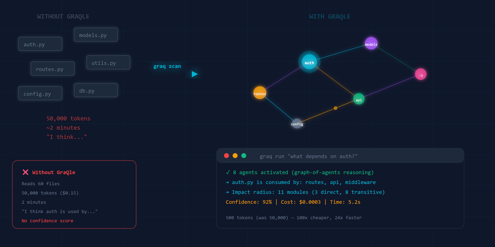

<div align="center">



# GraQle

**Give your AI agents a memory of how your organisation works - and check every decision before they act.**

[](https://pypi.org/project/graqle/)
[](https://python.org)
[]()
[](#trust)

```bash
pip install graqle
```

[Website](https://graqle.com) · [Quickstart](#quickstart) · [Decision Assurance](#check-every-decision) · [Shared memory](#one-memory-for-a-team-of-agents) · [Changelog](./CHANGELOG.md)

<!-- mcp-name: io.github.quantamixsol/graqle -->

</div>

---

## What GraQle does

1. **Remembers.** Turns your code, documents, policies and decisions into one connected knowledge graph that lasts beyond a chat session.
2. **Checks.** Before an agent acts, the Decision Assurance Gate checks the action and answers **EXECUTE, REPLAN, HOLD, REJECT or ESCALATE** - with the reason and a signed record.
3. **Shares.** One graph serves a whole team of agents - Claude Code, Cursor, Codex, Copilot - each with its own permissions and its own files.

Works with any model: Anthropic, OpenAI, AWS Bedrock, Ollama, Gemini and more - or fully offline.

---

## Quickstart

```bash
pip install graqle

graq scan docs ./policies          # documents, policies, ADRs -> graph
graq scan repo .                   # code -> the same graph
graq learn knowledge "vendor DPA must be signed before any data access"
graq run "what approval is needed for a large refund?"
# -> answer + confidence + the exact sources it used
```

Connect it to your AI tool (Claude Code, Cursor, Windsurf, VS Code):

```bash
graq init        # detects your IDE and wires GraQle in
```

PDF, DOCX, PPTX and XLSX: `pip install "graqle[docs]"`.

---

## Check every decision

Most AI tools give you one confidence number. GraQle asks separate questions before an agent acts - and a good answer to one never hides a failed answer to another:

- **Allowed?** Policy valid, actor authorised, evidence current, arguments exactly the approved ones. Any "no" stops the action.
- **Consistent?** Contradicting facts are tracked in the graph, and a change updates every decision that depends on it.
- **Sure enough?** Confidence is measured per dimension, not blended into one score.
- **On track?** Unreliable step sequences are sent back to replan within a retry budget.
- **Who approves?** Authority is checked for the action's impact level.

| Answer | Meaning |
|---|---|
| `EXECUTE` | Everything checks out. Impossible after any failed check or error. |
| `REPLAN` | Make a better plan and try again. |
| `HOLD` | Something important is missing; wait for it. |
| `REJECT` | Not allowed, or contradicted by the evidence. |
| `ESCALATE` | A human decides. |

```python
from graqle.assurance.gate import DecisionAssuranceGate

verdict = gate.evaluate(candidate, ctx)
verdict.outcome         # EXECUTE | REPLAN | HOLD | REJECT | ESCALATE
verdict.decisive_rule   # which rule decided
verdict.reason_codes    # why
```

**Every decision leaves a sealed record:** a signed, hash-chained provenance event, exportable to W3C PROV-O and checkable with SHACL, so an auditor can verify it with standard tools. The gate is **off by default**: installing or upgrading GraQle changes nothing until you switch it on.

**Turn it on, per project:**

1. Set `GRAQLE_DAG_ENABLED=true` in the environment where GraQle runs (or in your `.env`).
2. Provide the required settings. GraQle ships no thresholds, salts or keys: you choose them. Start from the `GRAQLE_DAG_*` section of [`.env.example`](./.env.example) and fill in every placeholder (salt, thresholds, signing key id and version, calibrator version, and the others listed there). Put the values in the environment, or in a private file at `GRAQLE_DAG_SECRETS_PATH` (default `.graqle/graqle_secrets.yaml`); the environment wins.
3. Start as usual. If a required value is missing, GraQle raises a configuration error that names it the first time the gate settings load. There is no silent fallback.

Check it: `python -c "from graqle.assurance.settings import is_dag_enabled; print(is_dag_enabled())"` prints `True`.

To switch it off again, unset the flag or set it to `false`. Details: [operating the gate](./docs/dag/ground-truth-addendum.md).

---

## One memory for a team of agents

Several agents on one codebase usually means several copies of the same graph in memory. GraQle can hold it once:

```bash
# where the graph lives
graq mcp serve --transport http --port 8765 --config graqle.yaml --allowed-roots /path/to/projects

# in each agent session (.mcp.json)
{ "mcpServers": { "graqle": { "command": "graq", "args": ["mcp", "relay", "--url", "http://127.0.0.1:8765"] } } }
```

- **Less memory.** Each session runs a small relay instead of a full copy ([measured](./scripts/cr_infra_02c_measure_rss.output.txt) on a 20,000-node graph: 3 separate servers 687 MB, shared server + 3 relays 493 MB).
- **Learning is shared at once** across all sessions.
- **Each session keeps its own gates and its own files** - file work happens on each user's own machine.
- **Teammates connect** over an SSH tunnel, or HTTPS with a token.
- **Several projects, separate graphs** on one server (Team and Enterprise).

### Turn on the decision gate (opt-in, baseline tier)

The decision gate is off unless `GRAQLE_DAG_ENABLED` is set; with it off nothing changes. Turn it on:

1. Create an ed25519 signing key (PEM, mode `0600`) and a key manifest that lists its public key
   (`graqle.assurance.key_manifest_store.save_manifest`), plus a coverage policy file.
2. Set `GRAQLE_DAG_ENABLED=1` and the required `GRAQLE_DAG_*` settings: `SIGNING_KEY_ID`,
   `SIGNING_KEY_VERSION`, `SIGNING_KEY_PATH`, `COVERAGE_POLICY_PATH`, `CONFIG_SALT`, `CAP_VALUE`,
   `HG05_POISONING_THRESHOLD`, `HG07_MATERIALITY_THRESHOLD`, `CALIBRATOR_VERSION`,
   `TRAJECTORY_ESTIMATOR`, `MAX_RETRY_BUDGET`, `CIRCUIT_BREAKER_WINDOW`, `SCOPE_KEY_FIELDS_REF`,
   `MERGE_PRIORITY_REF`. There are no built-in values for these; you choose them.
3. Register the actors that may take MEDIUM-risk calls (for example `GRAQLE_RBAC_ACTORS_JSON`). An
   actor with no registered role is closed by hard gate HG-06.
4. Start your process. The packaged default runtime provider is registered at start-up. If it
   cannot be built the process fails at start-up with an error naming `register_runtime`; supply
   your own provider with `graqle.assurance.adapter.register_runtime(provider)` if you need one.

Baseline-tier decisions are governed by rule `DAG-RT-BASELINE-ADMIT`. No projection score,
reliability or residual risk is computed or recorded for them. EXECUTE only when risk is LOW,
impact is zero and all hard gates pass; anything else is HOLD (`DAG-RT-NO-EVIDENCE`) or, when a
hard gate fails, REJECT. MEDIUM and above routing requires explicit configuration. Every decision
is written as a signed, hash-chained provenance event; if it cannot be written the call is not
executed.

This is a policy-scoped authorisation at evidence tier BASELINE. It is not informed by the graph
and is not a safety verification. Evidence-fed scoring arrives in 0.88 (CR-DAG-088-1).
`python scripts/dag_wheel_e2e.py` runs these steps against the built wheel in a clean virtualenv.

---

## Trust

- **Local-first, no telemetry.** The graph is a file you control; nothing phones home.
- **Secure by default.** The server needs authentication unless you explicitly switch on local development mode; graph uploads can never silently overwrite each other.
- **Signed releases.** Sigstore-signed wheels, CycloneDX SBOM, reproducible builds.
- **Regulated work.** Audit trail and evidence exports for your own EU AI Act file - GraQle provides evidence, it does not claim to make you compliant. [Details](./docs/compliance/eu-ai-act/)

Report vulnerabilities to **security@quantamixsolutions.com** · [SECURITY.md](./SECURITY.md)

---

## Used in CrawlQ Ledger

[CrawlQ Ledger](https://crawlq.ai/ledger) is a desktop app for Windows and Mac built on GraQle. On your own computer it reads the mail, Slack, Drive and folders you connect, links people, promises and messages in a GraQle graph, and runs agents that act only where you have approved them, with a signed receipt for every action. Your AI tools (Claude, ChatGPT, Cursor, Claude Code) can query that graph through the Ledger's MCP server, so they answer from your records instead of guessing.

- Ledger Solo includes GraQle Community (graph up to 1,000 entries).
- Ledger Pro includes a lifetime GraQle Pro licence, Business a lifetime GraQle Pro licence for 3 seats, and Team a lifetime GraQle Team licence for 5 seats.

---

## Editions

| | What you get |
|---|---|
| **Free** | Knowledge graph, all core tools, governance gates, Decision Assurance Gate, shared server for one project |
| **Pro — $19/mo** | Cloud sync, priority models, hosted transparency-log relay |
| **Team — $29/dev/mo** | Shared graphs across projects (multi-project server), team lessons, audit-log retention |
| **Enterprise** | On-premise, custom backends, support SLAs - [contact us](mailto:sales@quantamixsolutions.com) |

---

## Recent releases

- **v0.87.0** — Decision Assurance Gate: five-answer decisions, contradiction tracking, confidence per dimension, replanning, signed provenance records.
- **v0.86.0** — One memory for a team of agents: shared server, thin relay, per-session gates, file work on each user's machine; secure-by-default server.

[Full changelog](./CHANGELOG.md)

---

## Patent & license

Core methods are patent-pending: **EP26167849.4**, **EP26162901.8** and **EP26166054.2**. Source is fully auditable under the GraQle License - see [LICENSE](./LICENSE).

<div align="center">

**Built by [Quantamix Solutions](https://quantamixsolutions.com)** · [github.com/quantamixsol/graqle](https://github.com/quantamixsol/graqle)

</div>
